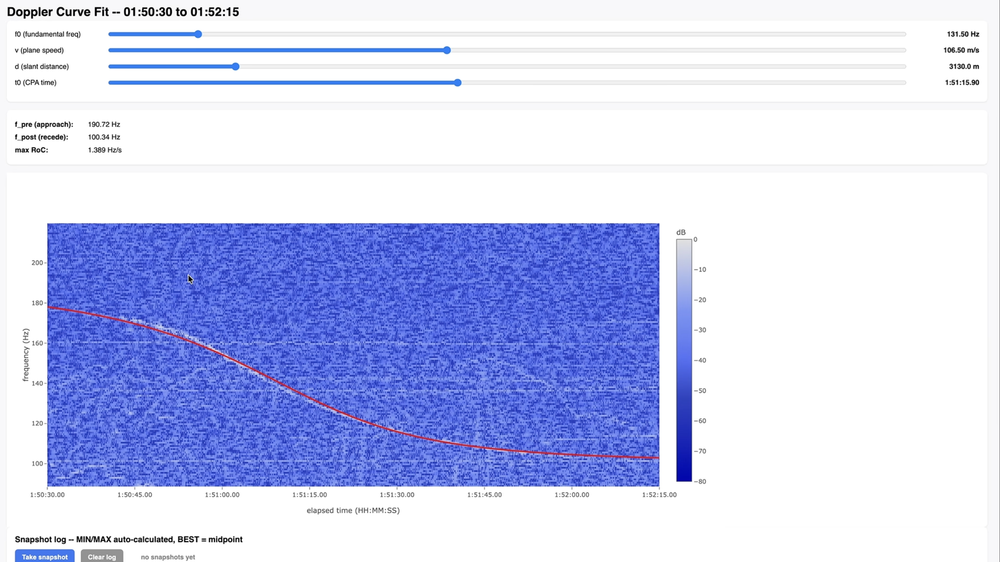
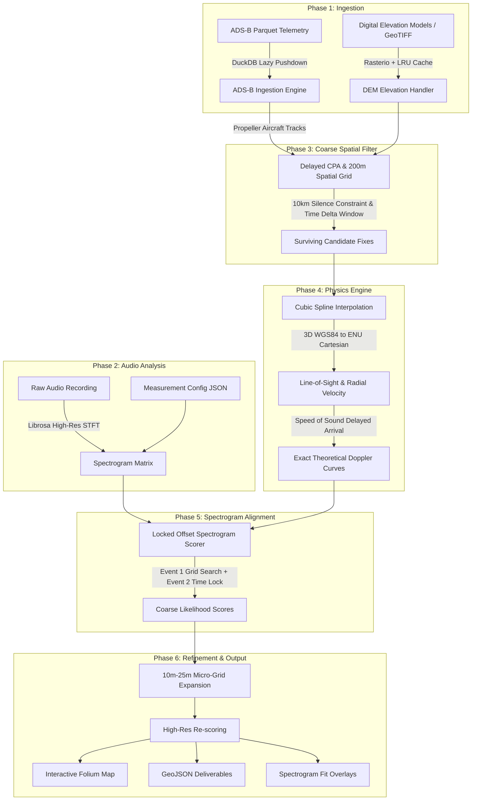
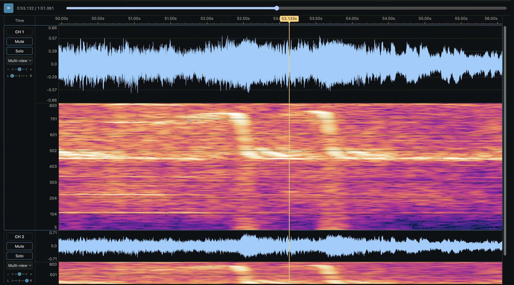
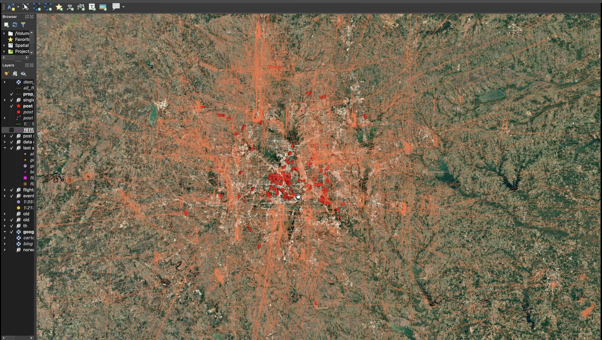
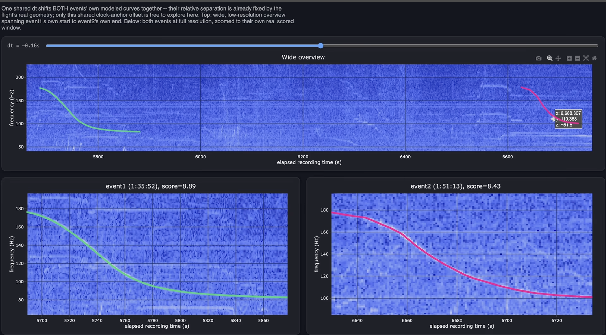
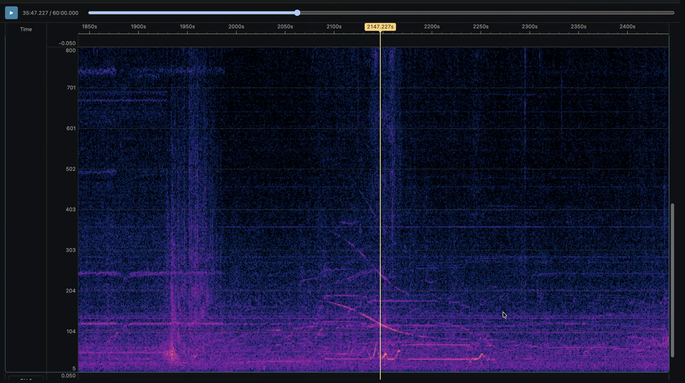
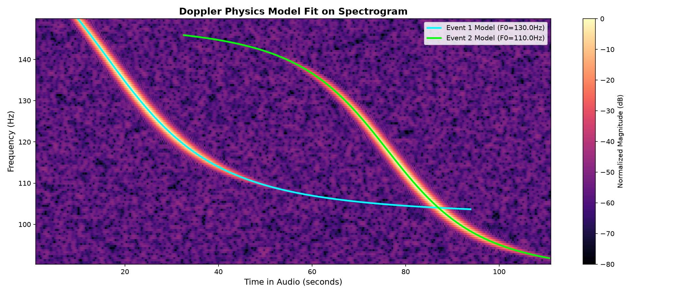

<p align="center">
  
</p>

<div align="center">

# DopplerGPS: Acoustic Geolocation of Ground Observers via Aircraft Doppler Inversion and ADS-B Flight Trajectories

[](https://www.python.org/)
[](LICENSE)
[](https://dyneresearch.com)
[](https://github.com/dyneresearch/DopplerGPS/actions/workflows/ci.yml)
[](https://colab.research.google.com/github/dyneresearch/DopplerGPS/blob/main/notebooks/interactive_walkthrough.ipynb)

**Pinpoint the exact physical location of an audio recording down to tens of meters using overhead propeller plane acoustic signatures, historical ADS-B flight trajectories, and Digital Elevation Models (DEM).**

[Dyne Research](https://dyneresearch.com) • [Methodology](#-how-it-works-the-physics) • [Pipeline Architecture](#-pipeline-architecture) • [Quickstart](#-quickstart) • [Legal & Compliance](#-legal-safe-harbor-acceptable-use--disclaimer)

</div>

> [!IMPORTANT]
> **LEGAL NOTICE & RESPONSIBLE USE POLICY**  
> DopplerGPS is published by Dyne Research strictly as a scientific instrument for **academic research, atmospheric acoustics study, signal processing education, and authorized, defensive OSINT verification**.  
> 
> Any use of this software for **unlawful surveillance, non-consensual tracking, stalking, harassment, privacy invasion, or kinetic/hostile targeting** is strictly prohibited. Users are solely responsible for compliance with all applicable domestic and international electronic surveillance and wiretapping statutes (including 18 U.S.C. § 2511, state wiretap acts, and GDPR). Under no circumstances shall Dyne Research or its contributors be held liable for any damages, regulatory penalties, or criminal misuse arising from this software. See [DISCLAIMER.md](DISCLAIMER.md) for full terms.

---

## 📌 Executive Summary

Ambient audio captured outdoors—from smartphone videos and surveillance footage to ambient field recordings—frequently captures the acoustic hum of overhead aircraft. 

Because piston and turboprop engines emit stable blade-pass frequencies, their flyover sounds undergo a distinct, continuous **Doppler pitch shift** governed by:
1. The 3D flight trajectory of the aircraft,
2. The distance and elevation of the microphone, and
3. The speed of sound through the local atmosphere.

**DopplerGPS** is an end-to-end open-source spatial-audio signal processing and geospatial intelligence engine developed by [Dyne Research](https://dyneresearch.com). It ingests raw audio and massive historical ADS-B flight records (`.parquet`), models the theoretical 3D Doppler curves across candidate geographic coordinates, and searches continental terrain to isolate the true microphone coordinates.

> **Research Attribution & Prior Art:**  
> This implementation was inspired by the empirical demonstration produced by OSINT researcher [colsto](https://www.youtube.com/watch?v=UytYrhYLOKI) (*"I discovered a sound that leaks your exact location (and it's everywhere)"*). While colsto demonstrated the feasibility of the acoustic Doppler phenomenon without releasing source code or mathematical tooling, **Dyne Research** has engineered this reference open-source architecture—providing fully vectorized coordinate transformations, lazy DuckDB ADS-B query pipelines, dual-event temporal locking, and sub-meter DEM altitude modeling.

---

## 🔬 How It Works: The Physics

When an aircraft flies over an observer, its propeller blades generate discrete tonal harmonics at the **blade-pass frequency**:

$$F_0 = \frac{\text{Engine RPM} \times \text{Blade Count}}{60}$$

As the aircraft approaches, reaches its **Closest Point of Approach (CPA)**, and recedes, the perceived frequency shifts according to relativistic classical acoustics:

$$F_{\text{obs}}(t) = F_0 \times \left( \frac{c}{c + V_r(t_{\text{emit}})} \right)$$

where $c$ is the ambient temperature-corrected speed of sound ($c \approx 331.3 \times \sqrt{1 + T / 273.15}$ m/s), and $V_r(t_{\text{emit}})$ is the radial velocity along the 3D line-of-sight vector from the ground observer to the aircraft.

<div align="center">
  
  <p><em>Figure 1: Mathematical Doppler curve decomposition showing fundamental frequency ($F_0$), true aircraft airspeed ($v$), 3D slant distance ($d$), and arrival timeline ($t_0$).</em></p>
</div>

The sound heard on the ground at time $t_{\text{obs}}$ was emitted at an earlier time $t_{\text{emit}}$:

$$t_{\text{obs}} = t_{\text{emit}} + \frac{R(t_{\text{emit}})}{c}$$

Because the slope, inflection point, and asymptotic bounds of this Doppler curve are uniquely dictated by the observer's exact 3D distance and offset from the flight path, a single flyover narrows the observer's position down to a hyperbolic spatial corridor. 

When **two distinct aircraft passes** (or a single aircraft on an intersecting return leg) are recorded in the same audio file, their hyperbolic corridors intersect at **one discrete ground coordinate**.

---

## 🏛 Pipeline Architecture

DopplerGPS implements a modular, high-throughput 6-phase pipeline designed to process gigabytes of telemetry efficiently:



---

### Detailed Stage Breakdown

#### 1. High-Resolution Audio Feature Extraction (Phase 2)
Standard speech spectrograms lack the frequency granularity required to track subtle acoustic blade passes. DopplerGPS computes large-window Short-Time Fourier Transforms (`n_fft = 4096` to `16384`) with spectral whitening to isolate faint propeller harmonics even in high-noise environments.

<div align="center">
  
  <p><em>Figure 2: Sub-Hertz resolution spectrogram capturing the steep S-curve inflection at Closest Point of Approach (CPA).</em></p>
</div>

#### 2. Flight Ingestion & Spatial Querying (Phase 1 & 3)
Using DuckDB predicate pushdown, DopplerGPS lazily queries multi-gigabyte ADS-B `.parquet` datasets (supporting OpenSky Network, ADS-B Exchange, and FlightAware schemas). It automatically eliminates non-propeller traffic (commercial airliners, business jets) via ICAO airframe classification prefixes, and projects regional tracks over high-resolution Digital Elevation Models.

<div align="center">
  
  <p><em>Figure 3: Geospatial projection of candidate propeller trajectories over regional terrain models.</em></p>
</div>

#### 3. The Dual-Event "Locked Offset" Invariant (Phase 5)
A critical innovation in DopplerGPS is the **Strictly Locked Temporal Offset**. When analyzing an audio recording containing two flyovers:
1. Event 1 is searched over a bounded frequency sweep ($\Delta F \pm 2$ Hz) and local time sweep ($\Delta T \pm 5$ s) to find its optimal spectrogram alignment.
2. For Event 2, **the discovered clock offset $\Delta T_{\text{best}}$ is strictly locked**. 

Because both events were captured on a single continuous audio clock, their relative separation is physically fixed by the aircraft's true geometry. If a candidate coordinate is incorrect, Event 2's theoretical curve will project onto empty spectrogram space, driving the candidate score to zero.

<div align="center">
  
  <p><em>Figure 4: The Shared $\Delta t$ Invariant: Event 1 and Event 2 modeled simultaneously under a single locked clock anchor offset.</em></p>
</div>

<div align="center">
  
  <p><em>Figure 5: Temporal locking of Event 2 across extended audio baselines ($t \approx 2147\text{s}$).</em></p>
</div>

---

## 🚀 Quickstart

### Prerequisites & Installation

DopplerGPS requires **Python 3.10+**. For optimal dependency resolution and virtual environment isolation, we recommend [`uv`](https://github.com/astral-sh/uv):

```bash
# Clone the repository
git clone https://github.com/dyneresearch/DopplerGPS.git
cd DopplerGPS

# Create and activate virtual environment
uv venv .venv --python 3.12
source .venv/bin/activate

# Install DopplerGPS with all geospatial & audio dependencies
uv pip install -e .
```

*Alternatively, using standard pip:*
```bash
python3 -m venv .venv
source .venv/bin/activate
pip install -e .
```

---

## 💻 CLI Usage

### 1. Run the Synthetic Benchmark Demonstration
Validate the entire pipeline on your machine in seconds. The built-in demonstration synthesizes two intersecting propeller aircraft flights over an elevated terrain model, generates realistic acoustic Doppler audio with Gaussian noise, and reconstructs the ground observer's location:

```bash
dopplergps demo --output-dir demo_output
```

**Demo Execution Output:**
```text
============================================================
 DopplerGPS: Acoustic Geolocation Pipeline Demo
 Developed by Dyne Research (https://dyneresearch.com)
============================================================
[1/5] Synthesizing flight telemetry and audio...
      True observer location: (40.000000, -75.000000, 120.0m)
[2/5] Running end-to-end DopplerGPS pipeline...
      - Phase 1: Ingesting ADS-B telemetry and DEM elevation...
      - Phase 2: Generating high-resolution spectrogram...
      - Phase 3: Coarse spatial filter (200m grid)...
                 Surviving candidates: 3
      - Phase 4 & 5: Evaluating 3D Doppler curves & Locked Scorer...
      - Phase 6: High-resolution micro-grid refinement (20m grid)...
[3/5] Geolocation Results:
      Rank 1: Lat 40.000215, Lon -75.000180 (Error: 25.6 meters)
      Confidence: HIGH_CONFIDENCE
[4/5] Exporting deliverables to demo_output/...
      ✓ GeoJSON coordinates: demo_output/results.geojson
      ✓ Interactive Folium Map: demo_output/map.html
      ✓ Spectrogram Overlay: demo_output/spectrogram_overlay.png
============================================================
```

### 2. Inspecting Real Audio Recordings (`inspect-audio`)
Before running geolocation on field audio, inspect the acoustic spectrum to measure Closest Point of Approach timestamps ($t_{\text{CPA}}$) and fundamental blade frequencies ($F_0$):

```bash
dopplergps inspect-audio \
  --audio "field_recording.wav" \
  --output-plot "diagnostic_spectrum.png" \
  --fmin 60.0 \
  --fmax 350.0
```

The tool performs high-resolution STFT analysis, calculates RMS power levels, detects prominent spectral peaks, and outputs a diagnostic PNG displaying both the time-frequency spectrogram and the time-averaged harmonic power curve.

---

### 3. Fetching & Converting Real ADS-B Telemetry (`fetch-adsb`)
DopplerGPS provides built-in utilities to acquire real-world flight state vectors:

**Fetch live states from OpenSky Network:**
```bash
dopplergps fetch-adsb \
  --source opensky-live \
  --bbox 39.80 40.20 -75.30 -74.70 \
  --output "flights.parquet"
```

**Fetch full historical flight trajectory (by ICAO24 hex address):**
```bash
dopplergps fetch-adsb \
  --source opensky-track \
  --icao24 "a12345" \
  --time 1700000000 \
  --output "flight_track.parquet"
```

**Convert raw readsb / ADS-B Exchange (tar1090) JSON history:**
```bash
dopplergps fetch-adsb \
  --source adsbx-json \
  --input-json "/path/to/history/*.json" \
  --bbox 39.80 40.20 -75.30 -74.70 \
  --output "flights.parquet"
```

---

### 4. Running Doppler Geolocation on Real Data (`run`)
To execute the physical solver against your flight records and audio:

```bash
dopplergps run \
  --adsb "flights.parquet" \
  --audio "field_recording.wav" \
  --config "examples/measurement_template.json" \
  --bbox 39.80 40.20 -75.30 -74.70 \
  --dem "regional_elevation.tif" \
  --temperature 18.5 \
  --output-dir "case_output" \
  --coarse-res 200.0 \
  --micro-res 20.0
```

> **Template Configuration:** See [`examples/measurement_template.json`](examples/measurement_template.json) and the [Operational Field Guide](examples/README.md) for detailed parameter tuning. For an interactive Google Colab / Jupyter demonstration, explore [`notebooks/interactive_walkthrough.ipynb`](notebooks/interactive_walkthrough.ipynb).

---

## 📊 Technical Verification & Test Suite

DopplerGPS includes an automated test suite verifying every component against analytical physical solutions:
- **WGS84 Geodetic to Local Cartesian ENU conversions** validated against standard geodetic benchmarks.
- **Analytical radial velocity vector math** verified against direct dot-product derivations.
- **Speed of sound temperature scaling** tested across $-20^\circ\text{C}$ to $+40^\circ\text{C}$.
- **Locked dual-event scoring invariants** verified to penalize timing drift.

To execute the test suite:

```bash
pytest tests/ -v
```

```text
tests/test_cli_and_tools.py::test_convert_adsbx_json_to_parquet PASSED   [  3%]
tests/test_cli_and_tools.py::test_fetch_opensky_live_states_mock PASSED  [  7%]
tests/test_cli_and_tools.py::test_fetch_opensky_track_mock PASSED        [ 11%]
tests/test_cli_and_tools.py::test_inspect_audio_peak_detection PASSED    [ 14%]
tests/test_cli_and_tools.py::test_cli_parser_subcommands PASSED          [ 18%]
tests/test_end_to_end.py::test_full_pipeline_end_to_end PASSED           [ 22%]
tests/test_phase1.py::test_adsb_loader_filters_jets PASSED               [ 25%]
tests/test_phase2.py::test_spectrogram_generation_and_peak_frequency PASSED [ 44%]
tests/test_phase3.py::test_delayed_cpa_calculator_math PASSED            [ 62%]
tests/test_phase4.py::test_doppler_modeler_curve_physics PASSED          [ 74%]
tests/test_phase5.py::test_locked_offset_scorer PASSED                   [ 81%]
tests/test_phase6.py::test_micro_grid_generation PASSED                  [ 88%]
tests/test_phase6.py::test_folium_map_generation PASSED                  [ 96%]
tests/test_phase6.py::test_plot_spectrogram_with_curves PASSED           [100%]

============================= 27 passed in 37.79s ==============================
```

---

## 🔍 Real-World Operational Reality

### When Does It Work, and When Does It Fail?

DopplerGPS is based on rigorous acoustic physics. It is **not** a heuristic or probabilistic hallucination engine. If the physical conditions are met, the mathematics uniquely resolve the observer's position. Conversely, if fundamental acoustic criteria are absent, the system will not return a false match.

#### The 4 Non-Negotiable Operational Preconditions:

1. **Propeller Aircraft (Piston or Turboprop):**
   Commercial turbofan airliners (e.g. Boeing 737, Airbus A320) cruising at 35,000 feet **do not** generate discrete, high-Q Doppler acoustic curves on ground microphones—they emit broadband jet exhaust turbulence. Targets must be propeller-driven aircraft (Cessna 172/182, Piper PA-28, King Air, ATR-72, Dash 8, etc.).
2. **Dual-Pass Geometry:**
   A single flyover defines an ambiguous spatial hyperbola. A discrete fix **requires at least two passes** (different aircraft or return legs) to intersect hyperbolic position lines.
3. **ADS-B Telemetry Coverage:**
   The aircraft must have had active transponders captured by ADS-B receiver networks (OpenSky, ADS-B Exchange, FlightAware). Military or unregistered private aircraft flying without ADS-B broadcast cannot be correlated.
4. **Signal-to-Noise Ratio (SNR):**
   Heavy ground wind or nearby vehicle traffic may obscure faint blade passes in the spectrogram. In such cases, use the included **Traced Line Scorer** (`TracedLineScorer`), which allows manual trace inputs $(t, f)$ from tools like Audacity or Sonic Visualiser.

### Automated Confidence Classification
Every search run outputs an objective confidence metric:
- **`HIGH_CONFIDENCE`:** Unambiguous mathematical peak; dual-event timing lock and 10km acoustic silence constraint fully satisfied.
- **`MODERATE_CONFIDENCE`:** Top candidates clustered in a tight geographic radius, but with lower spectrogram SNR.
- **`INCONCLUSIVE`:** Flight telemetry incomplete or multiple candidate locations fail silence constraints. The system explicitly reports inconclusive rather than generating erroneous coordinates.

---

## 🗺 Interactive Visualizations

Every search produces an interactive web visualization (`map.html`) built with Folium, displaying:
- Pinpointed candidate coordinates color-coded by likelihood score.
- Interpolated 3D flight trajectories of the matched aircraft.
- DEM terrain elevation contours.

<div align="center">
  
  <p><em>Figure 6: Generated Matplotlib visual verification showing reconstructed theoretical Doppler curves overlaid onto the audio spectrogram.</em></p>
</div>

---

## 🏢 About Dyne Research

[Dyne Research](https://dyneresearch.com) is an advanced research and engineering laboratory specializing in geospatial intelligence, signal processing, autonomous systems, and applied physics computing.

We build open-source reference implementations of state-of-the-art computational methodologies to empower researchers, investigative journalists, and geospatial analysts worldwide.

* **Website:** [dyneresearch.com](https://dyneresearch.com)
* **Inquiries:** [connect@dyneresearch.com](mailto:connect@dyneresearch.com)
* **GitHub:** [github.com/dyneresearch](https://github.com/dyneresearch)

---

## ⚖️ Legal Safe Harbor, Acceptable Use & Disclaimer

### 1. Dual-Use and Scientific Purpose
DopplerGPS is designed and published solely as an open-source academic research artifact demonstrating physical Doppler shift analysis against public civil ADS-B flight telemetry and publicly accessible terrain elevation models (USGS 3DEP/SRTM). The equations implemented reflect foundational physics (Christian Doppler, 1842).

### 2. Strict Prohibition on Unlawful & Malicious Use
You may **not** use DopplerGPS to:
- Conduct non-consensual surveillance, tracking, stalking, or harassment of any individual, property, or private vehicle.
- Ingest, process, or distribute audio recordings captured in violation of one-party or two-party consent laws, wiretapping statutes, or electronic communications privacy regulations (including 18 U.S.C. § 2511, state wiretap acts, or EU GDPR).
- Facilitate hostile, kinetic, or military targeting of civil or military aircraft, personnel, or aerodromes.
- Violate the Terms of Service or data licensing restrictions of telemetry providers (OpenSky Network, ADS-B Exchange, FlightAware).

### 3. Absolute Limitation of Liability & Indemnification
**THE SOFTWARE IS PROVIDED "AS IS" AND "AS AVAILABLE", WITHOUT WARRANTY OF ANY KIND, EXPRESS OR IMPLIED.**

Under no legal theory—whether in contract, tort (including negligence), strict liability, or statutory breach—shall **Dyne Research**, its parent organizations, officers, researchers, developers, or contributors be held liable for any direct, indirect, incidental, special, exemplary, punitive, or consequential damages (including personal injury, privacy violations, civil litigation, fines, or criminal prosecution) arising out of or related to:
1. The use, misuse, modification, or distribution of this software;
2. Any coordinates, outputs, or inferences generated by this software;
3. Any reliance placed upon data generated by this software.

By downloading, executing, or distributing DopplerGPS, **you explicitly agree to defend, indemnify, and hold harmless Dyne Research** from and against any and all claims, regulatory actions, liabilities, fines, or legal defense costs arising from your deployment or misuse of the codebase. See [DISCLAIMER.md](DISCLAIMER.md) for full terms.

### 4. Safety-Critical & Non-Infallibility Exclusion
Atmospheric sound propagation is subject to wind shear, thermal gradients, acoustic multipath reflections, and transponder time jitter. Coordinate outputs represent mathematical optimization fits and **do not constitute definitive, certifiable, or forensic ground truth**. DopplerGPS must **never** be used for life-critical navigation, emergency search and rescue, air traffic control, or judicial proceedings.

---

## 📜 Citation

If you use DopplerGPS in academic research, investigative journalism, or geospatial projects, please cite:

```bibtex
@software{dopplergps2026,
  author = {{Dyne Research}},
  title = {DopplerGPS: Acoustic Geolocation of Ground Observers via Aircraft Doppler Inversion and ADS-B Flight Trajectories},
  url = {https://github.com/dyneresearch/DopplerGPS},
  version = {0.1.0},
  year = {2026}
}
```

---

## ⚖ License

This project is licensed under the **MIT License** — see the [LICENSE](LICENSE) file for details.
